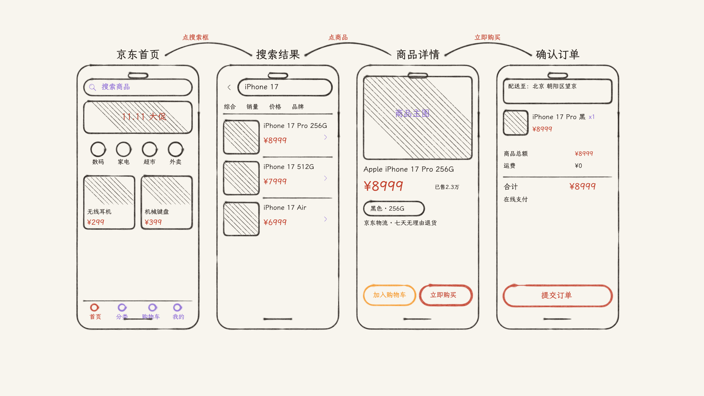
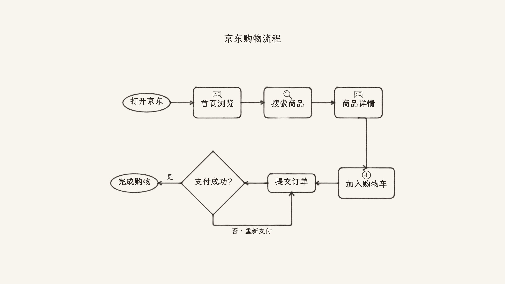

# sketchpad · 手绘板

[English](README.en.md) · **中文**

> **让 AI agent 把想法画成一张手绘白板，你在浏览器里实时看着它画。**

[](https://www.npmjs.com/package/@content-forge/sketchpad)
[](LICENSE)
[](https://github.com/marrviin/sketchpad)
[](https://github.com/marrviin/sketchpad/pulls)

---

## 它是什么

sketchpad 是一块 **agent 驱动**的手绘白板。人不碰笔——你用自然语言让 agent 画架构图、流程图、原型草图、手绘 icon，每一笔经 SSE 秒级出现在浏览器里。页面是纯查看器：拖拽平移、滚轮缩放、切换画布、叙事回放，作画全部交给 agent。

风格是纸笔手绘（笔刷质感、颗粒、压力、手写字体），不是默认的矢量图形库。

## 安装

```bash
npx skills add marrviin/sketchpad
```

装完在 Claude Code 里直接说一句——

> 帮我画一张登录流程图

agent 自己起画板、构图、落笔、自查，**你在旁边浏览器里看着它画**。不用记命令、不用手动安装，skill 把「画 → 自查 → 修正」的工作流全包了。

## 效果演示

| 多屏原型动线（叙事回放） | 流程图（compose 场景构图） |
|---|---|
| <video src="docs/demo-wireframe.mp4" controls muted loop></video> | <video src="docs/demo-flow.mp4" controls muted loop></video> |
|  |  |

## 能画什么

- **手绘架构图 / 流程图**：方框、箭头、连接线，网格定位对齐；spline 过点平滑曲线，hatch 画排线阴影
- **手绘风原型草图**：页面骨架、设备框、分区、卡片——叙事层级从背景到标注逐层铺开
- **手绘 icon**：内置 160 个手绘 icon（数据库、云、齿轮、人物……），按名字取用
- **白板演示**：毡头笔 / 毛笔 / 铅笔 / 马克笔 / 荧光笔 + 真实手写风字体

## 为什么不是 tldraw / excalidraw

| | 人画 | 让 agent 画 |
|---|---|---|
| tldraw / excalidraw | ✅ | 图形风、agent 画出来像 PPT |
| **sketchpad** | ❌（只看） | ✅ 手绘风 + agent 工作流（自查、lint、叙事回放） |

sketchpad 的设计目标不是「给人多一个画图工具」，而是「给 agent 一块像样的画板」——所以才内置 snapshot 自查、lint 几何体检、叙事分幕回放这些 agent 视角的能力。

## 工作原理

```
你 → Claude Code / agent
     ↓ 自然语言
     skill 指导 agent 调 CLI（sketchpad draw / compose / snapshot / lint）
     ↓ HTTP POST
   本地后端（.content-forge/sketchpad/<id>.json 落盘）
     ↓ SSE 推送增量
   浏览器页面（纯查看器，实时显示）
```

agent 每画完一张会 `snapshot` 渲染成 PNG 自己看，发现画歪了就 `undo` 重画——这个闭环不靠模型自觉，是工具保证的。

## 核心能力

- **实时同步**：每笔 SSE 秒级出现在页面，开个窗口挂旁边就是直播白板
- **多画布隔离**：每块画布独立 id / 版本 / 撤销栈，并发 agent 各绑一块互不影响
- **compose 场景构图**：流程图、时序图、原型骨架给结构化描述，内置确定性布局一次成图——对齐、间距、连线贴边、回退绕行都是算法保证，不靠模型手画
- **叙事分幕回放**：多屏产品动线每屏一幕，单视图按 画布 → 骨架 → 内容 → 标注 分层；页面右键「回放」或 `?replay=1` 逐幕演示
- **snapshot 自查回路**：`sketchpad snapshot` 渲染 PNG 给 agent 自己看，`lint` 把重叠 / 压线 / 出框变成可修的 id 清单，agent 直接删了重画
- **按比例思考**：支持 `unit: "norm"`（0~1 归一化），agent 按比例布局不用算像素

## 手动调用 CLI（可选）

skill 装好后一般不需要手动敲命令；想自己控制时：

```bash
npx -y @content-forge/sketchpad ui               # 拉起服务，打印页面地址
sketchpad new                                    # 新建画布
sketchpad compose @flow.json                     # 场景构图（flow/sequence/wireframe）
sketchpad draw '{"unit":"norm","shapes":[…]}'    # 手绘细节，页面实时看到
sketchpad lint                                   # 几何自查：重叠/压线/出框
sketchpad snapshot                               # 渲染 PNG 自查
sketchpad undo                                   # 撤销重来
```

skill 本体（完整创作工作流）见 [`packages/cli/skill/SKILL.md`](packages/cli/skill/SKILL.md)。

**daemon 集成**：装了 [`@content-forge/daemon`](https://www.npmjs.com/package/@content-forge/daemon) 时自动注册进守护进程，画板挂在 `/project/<项目名>/sketchpad/`；没有 daemon 就起本地常驻服务，开箱即用。

## License

MIT（内置字体各自遵循其 OFL 许可）。
